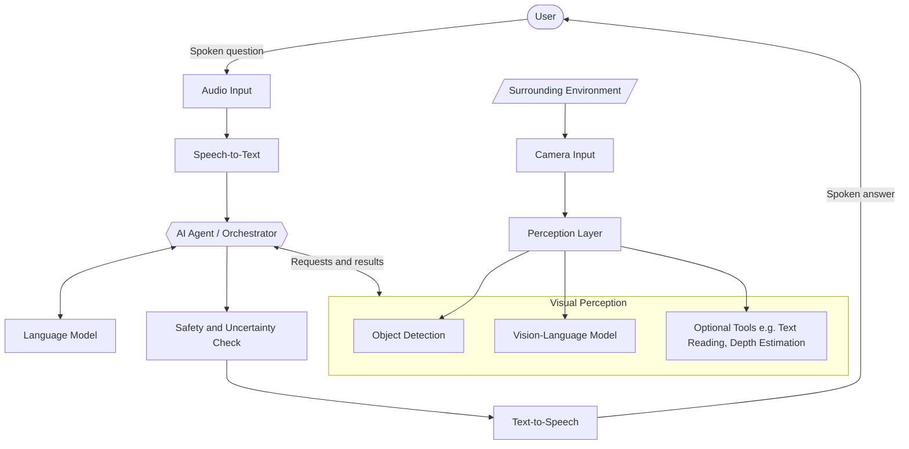
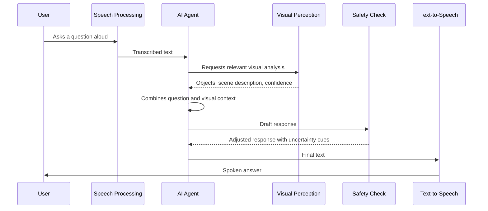

# NaviSense AI

**An AI-powered assistive technology concept for helping blind and visually impaired people understand their surroundings through computer vision and voice interaction.**

---

## Document Status and Scope

This document describes the **concept, intended capabilities, and conceptual architecture** of NaviSense AI. It is a design-level document, not a report of finished work.

| Aspect | Status |
|---|---|
| Project concept and goals | Defined in this document |
| Conceptual architecture | Proposed (see [System Architecture](#7-system-architecture)) |
| Individual capabilities (detection, Q&A, spoken output, etc.) | **Intended**; not assumed to be implemented |
| Real-world testing or user evaluation | **None claimed**; no verified performance data is presented |
| Safety certification or mobility-aid status | **Not applicable**; the system is not a mobility aid |

Throughout the document, statements such as "the system can" or "the system would" describe design intent. Any future claims about verified capability should be added only after structured testing, ideally with blind and visually impaired participants.

---

## Table of Contents

1. [Introduction](#1-introduction)
2. [Problem Statement](#2-problem-statement)
3. [Project Objectives](#3-project-objectives)
4. [Proposed Solution](#4-proposed-solution)
5. [System Overview](#5-system-overview)
6. [Technology Overview](#6-technology-overview)
7. [System Architecture](#7-system-architecture)
8. [General Workflow](#8-general-workflow)
9. [Potential Applications](#9-potential-applications)
10. [Challenges and Limitations](#10-challenges-and-limitations)
11. [Safety, Privacy, and Accessibility](#11-safety-privacy-and-accessibility)
12. [Future Development Opportunities](#12-future-development-opportunities)
13. [Conclusion](#13-conclusion)

---

## 1. Introduction

NaviSense AI is a proposed assistive technology that helps blind and visually impaired people learn about their surroundings through natural voice conversation. A user would ask a question aloud, such as "What is in front of me?" or "Is there a chair nearby?", and the system would answer in spoken language based on what a camera observes.

The project brings together several areas of artificial intelligence:

- **Computer vision** to perceive the environment
- **Vision-Language Models (VLMs)** to describe and reason about scenes
- **Large Language Models (LLMs)** to interpret questions and compose clear answers
- **Speech recognition and text-to-speech** to enable hands-free, voice-first interaction
- **AI agents** to coordinate these components into a single coherent experience

The central idea is to turn visual information into accessible, conversational information, so that the user decides what they want to know and when.

---

## 2. Problem Statement

Much of everyday life relies on visual information. Blind and visually impaired people often develop highly effective strategies for navigating the world, yet some situations remain difficult to handle independently:

- **Unfamiliar environments.** New buildings, streets, or rooms offer no prior mental map.
- **Changing surroundings.** Rearranged furniture, temporary obstacles, or crowds can alter a familiar space.
- **Visual-only content.** Signs, labels, packaging, and displays may not offer an accessible alternative.
- **Identifying objects.** Locating a specific item or confirming what an object is can be time-consuming.
- **Dependence on others.** Asking another person for help is not always possible, convenient, or desired.

Existing tools address parts of this problem, including white canes, guide dogs, screen readers, and various assistive apps. These tools remain essential. NaviSense AI explores a complementary approach: flexible, conversational access to visual context that responds to the specific question the user asks.

---

## 3. Project Objectives

### Primary Objectives

1. **Provide conversational access to visual information** so users can ask questions about their surroundings in natural language.
2. **Deliver spoken responses** that are concise, clear, and relevant to the question asked.
3. **Combine perception and language understanding** so answers are contextual rather than simple lists of detected objects.
4. **Communicate uncertainty honestly** so users are never given false confidence.

### Secondary Objectives

- Design a **modular architecture** in which components can be replaced or upgraded independently.
- Follow **accessibility-first** design principles, with voice as the primary interface.
- Respect **user privacy** and keep the user in control of when the system observes and speaks.
- Serve as a **well-documented reference project** for students, engineers, and collaborators interested in assistive AI.

### Intended Benefits

| Benefit | Description |
|---|---|
| Greater awareness | Users can obtain information about their surroundings on demand. |
| Flexibility | Natural-language questions replace fixed menus or preset commands. |
| Hands-free use | Voice interaction reduces reliance on screens or touch controls. |
| Extensibility | A modular design allows new capabilities to be added over time. |

---

## 4. Proposed Solution

NaviSense AI proposes a pipeline that links **seeing**, **listening**, **understanding**, and **speaking**:

1. **Seeing.** A camera supplies images or video of the user's surroundings. Computer vision components analyze them, identifying objects and describing scenes.
2. **Listening.** Speech recognition converts the user's spoken question into text.
3. **Understanding.** A language model, working with the visual information, interprets the question and determines what to report.
4. **Coordinating.** An AI agent layer decides which perception tools to use for a given question and gathers their outputs.
5. **Checking.** A safety layer reviews the response, ensuring that uncertainty is communicated and that the system does not overstate its reliability.
6. **Speaking.** Text-to-speech delivers the final answer to the user.

This approach combines the precision of specialized vision tools (for example, object detection) with the flexibility of language models (for example, answering open-ended questions). Neither alone fully serves the use case.

---

## 5. System Overview

At a conceptual level, NaviSense AI consists of five groups of components.

| Component Group | Role |
|---|---|
| **Input** | Captures the user's voice and the camera view of the environment. |
| **Perception** | Detects objects, interprets scenes, and may estimate approximate spatial relationships. |
| **Reasoning and Orchestration** | Interprets the user's request, selects the relevant perception outputs, and forms a response. |
| **Safety and Response Control** | Reviews responses, adds appropriate uncertainty language, and filters unsuitable content. |
| **Output** | Converts the final response to speech and delivers it to the user. |

These groups interact in a loop: the user speaks, the system perceives and reasons, and the system responds, after which the user can ask a follow-up question. Because the interaction is conversational, the system can in principle support follow-ups such as "What color is it?" or "Is it to my left or right?", provided the underlying components can support them reliably.

---

## 6. Technology Overview

The following technologies describe potential roles within the system. The project is intentionally **not tied to a specific tool, model, or vendor**; each role could be fulfilled by different technologies.

### 6.1 Object Detection

Object detection models locate and label objects within an image, typically producing a category and a position for each item. In NaviSense AI, this could provide structured facts such as "a chair is present in the lower-left of the view." Detection is limited to the categories a model has been trained to recognize and depends on image quality.

### 6.2 Vision-Language Models (VLMs)

VLMs accept an image together with a text prompt and generate a text response. They are well suited to open-ended descriptions and visual questions, such as summarizing a scene. They can also produce fluent but incorrect statements, so their outputs benefit from cross-checking and uncertainty handling.

### 6.3 Speech-to-Text (STT)

Speech recognition converts spoken questions into text. Accuracy can be affected by background noise, accents, speaking style, and microphone quality, which is especially relevant outdoors or in busy places.

### 6.4 Large Language Models (LLMs)

LLMs interpret user intent, combine information from different sources, and phrase answers in natural, concise language. Their role is to organize and communicate information, not to serve as an authoritative source of facts about the scene beyond what perception components provide.

### 6.5 AI Agent Frameworks

An agent framework lets a language model decide which tools to invoke, such as a detector, a scene describer, or a text reader, and then combine their results. This supports a modular design in which new tools can be added without redesigning the entire system.

### 6.6 Safety Mechanisms

Safety mechanisms are checks applied to the system's behavior and output. Examples of intended roles include:

- Adding hedging language when confidence is low
- Declining to answer when the visual evidence is insufficient
- Avoiding instructions that imply guaranteed safe passage
- Filtering inappropriate or sensitive content

### 6.7 Text-to-Speech (TTS)

TTS converts the final text response into audible speech. Important qualities include clarity, a natural pace, and adjustable speed and volume to suit individual preferences.

### Summary Table

| Technology | Potential Role | Key Consideration |
|---|---|---|
| Object detection | Structured identification of objects and positions | Limited to known categories |
| VLM | Scene description and visual question answering | May produce plausible but incorrect output |
| Speech-to-text | Understanding spoken requests | Sensitive to noise and accents |
| LLM | Interpreting intent and composing answers | Requires grounding in perception data |
| Agent framework | Coordinating tools | Adds complexity and potential latency |
| Safety layer | Reviewing and constraining responses | Cannot eliminate all errors |
| Text-to-speech | Spoken output | Must be clear and adjustable |

---

## 7. System Architecture

The diagram below shows the **proposed conceptual architecture**. It illustrates how the components relate and does not prescribe specific implementations.

### Layer Descriptions

| Layer | Description |
|---|---|
| **Input** | Audio from the user and imagery from the camera. |
| **Speech Processing** | Converts speech to text on the way in and text to speech on the way out. |
| **Perception** | A set of vision tools whose outputs describe the scene. |
| **Orchestration** | The AI agent interprets the request, calls relevant tools, and gathers results. |
| **Language Understanding** | The language model forms a clear, contextual answer from the available information. |
| **Safety** | Checks the response and ensures uncertainty is communicated before it is spoken. |
| **Output** | Spoken delivery of the final response. |

---

## 8. General Workflow

The conceptual flow from question to answer is as follows.

### Step-by-Step Description

1. **User input.** The user asks a question by voice.
2. **Speech recognition.** The audio is converted into text.
3. **Request interpretation.** The agent determines what the user is asking, for example identifying an object, describing a scene, or locating something.
4. **Visual analysis.** The relevant perception tools process the current camera view and return structured and descriptive information, ideally with confidence indicators.
5. **Contextual response generation.** The language model combines the question with the visual information to compose a concise, relevant answer.
6. **Safety and uncertainty review.** The response is checked, and wording is adjusted to reflect any uncertainty or limits of the visual evidence.
7. **Spoken output.** Text-to-speech delivers the answer, and the user may ask a follow-up question.

---

## 9. Potential Applications

The scenarios below are **illustrative possibilities**. They are not claims of validated performance, and each would require testing before being offered to real users.

| Scenario | Example Interaction | Value |
|---|---|---|
| **Understanding a room** | "What is in this room?" | Provides a general sense of an unfamiliar space. |
| **Finding an object** | "Is there a cup on the table?" | Helps confirm the presence or location of an item. |
| **Reading visible text** | "What does this sign say?" | Makes printed information more accessible, if supported by a text-reading tool. |
| **Identifying items** | "What is this object in my hand?" | Supports everyday tasks such as sorting household items. |
| **Scene awareness** | "Describe what is around me." | Offers general context, such as people nearby or furniture layout. |
| **Orientation in public spaces** | "Is there a door ahead?" | Adds information to what the user already gathers through other means. |

In every scenario, NaviSense AI is intended as a **supplementary information source**. It is not designed to replace a cane, a guide dog, orientation and mobility training, or the judgment of the user.

---

## 10. Challenges and Limitations

### 10.1 Visual Interpretation

Vision models can misidentify objects, miss small or partially hidden items, or struggle with unusual angles, clutter, or unfamiliar objects. Language models can add fluent but unsupported detail. Grounding responses in perception outputs and expressing uncertainty are important mitigations, though they do not remove the risk.

### 10.2 Distance and Spatial Estimation

Estimating how far away an object is, or exactly where it sits relative to the user, is difficult from a single camera view. Without dedicated depth sensing or calibration, distance statements may be inaccurate. The system should avoid presenting such estimates as precise measurements.

### 10.3 Speech Recognition

Noise, overlapping speech, accents, and speech differences can reduce transcription accuracy. A misheard question can lead to an irrelevant or misleading answer. Confirmation strategies may be needed for ambiguous requests.

### 10.4 Response Accuracy

Even when each component works as designed, errors can compound across the pipeline. A small perception error may be amplified by language generation into a confident-sounding but wrong statement.

### 10.5 Latency

Chaining speech recognition, vision, reasoning, and speech synthesis introduces delays. Slow responses may reduce usefulness, particularly when information is time-sensitive. The balance between response quality and speed is a central design trade-off.

### 10.6 Real-World Reliability

Lighting changes, motion blur, camera placement, weather, battery limits, and network availability all affect performance in real environments. Behavior in controlled settings may not reflect behavior in everyday use.

### 10.7 Summary of Key Limitations

| Area | Main Concern | General Direction for Mitigation |
|---|---|---|
| Visual interpretation | Misidentification or invented detail | Ground answers in perception outputs; express uncertainty |
| Distance estimation | Imprecise spatial information | Avoid precise claims; consider dedicated sensing in future |
| Speech recognition | Misheard requests | Confirm unclear requests; improve noise handling |
| Accuracy | Compounding errors | Cross-check outputs; test systematically |
| Latency | Delayed answers | Optimize pipeline; provide acknowledgment cues |
| Reliability | Variable real-world conditions | Staged testing across diverse conditions |

---

## 11. Safety, Privacy, and Accessibility

### 11.1 Responsible Use

NaviSense AI is an **informational assistant**. It does not guarantee safety, does not prevent accidents, and is not a substitute for established mobility aids or professional orientation and mobility training. The system should never present itself as confirming that a path is safe, and users should be informed of this clearly.

### 11.2 Communicating Uncertainty

Honest communication of uncertainty is a core design principle. Responses should reflect the system's actual confidence, for example by using phrases such as "it looks like," "I am not certain," or "I cannot see clearly." When the visual evidence is poor, the system should say so rather than guess. For high-stakes topics such as traffic or hazards, the system should avoid giving reassurance it cannot support.

### 11.3 User Privacy

A camera-based system can capture sensitive information about the user, bystanders, and private spaces. Recommended principles include:

- **Minimize collection.** Capture and process only what is needed to answer a request.
- **User control.** Make it clear when the camera and microphone are active, and let the user pause or stop them.
- **Limited retention.** Avoid storing images or audio unless the user knowingly chooses to.
- **Transparency.** Explain where data is processed, especially if external services are involved.
- **Respect for bystanders.** Consider the privacy of other people who may appear in the camera view.

### 11.4 Accessibility

Because the primary users are blind and visually impaired, accessibility should shape the design from the start:

- **Voice-first interaction** with no required visual interface
- **Concise, well-structured spoken responses** to avoid overload
- **Adjustable speech rate, volume, and verbosity**
- **Predictable behavior and consistent phrasing**
- **Involvement of the target community** in design, testing, and feedback, since lived experience is essential to building something genuinely useful

---

## 12. Future Development Opportunities

The following directions are possibilities for exploration. None is assumed to be planned or completed.

| Direction | Description |
|---|---|
| **Depth and spatial sensing** | Adding depth cameras or other sensors to improve distance and layout awareness. |
| **Text and document reading** | Stronger reading of signs, labels, menus, and printed materials. |
| **Face and person awareness** | Cautious, consent-based features, with careful attention to privacy and ethics. |
| **Memory and context** | Remembering relevant context within a session, such as previously described objects. |
| **Personalization** | Adapting verbosity, voice, and priorities to individual preferences. |
| **Multilingual support** | Supporting multiple languages and dialects for speech and responses. |
| **Wearable or mobile deployment** | Exploring head-mounted, chest-mounted, or smartphone-based hardware. |
| **On-device processing** | Reducing latency and improving privacy by running models locally where feasible. |
| **Proactive alerts** | Optional, user-controlled notifications, evaluated with extreme care for safety implications. |
| **Evaluation framework** | Structured testing protocols, benchmarks, and studies with user participation. |
| **Integration with other aids** | Working alongside navigation and mapping tools, not replacing them. |

---

## 13. Conclusion

NaviSense AI explores how computer vision, language models, and speech technology might work together to make visual information more accessible to blind and visually impaired people. Its core idea is simple: let users ask about their surroundings in their own words and receive clear, spoken answers.

The project's significance lies in combining specialized perception tools with the flexibility of conversational AI within a modular architecture, while placing safety, honesty about uncertainty, privacy, and accessibility at the center of the design.

Its value will depend on rigorous development and evaluation. The concepts here represent intended capabilities rather than verified results, and meaningful progress will require careful testing in real-world conditions and close collaboration with the people the technology aims to serve. If developed responsibly, NaviSense AI could become a useful complement to existing assistive tools, supporting greater independence and confidence in everyday life.

---

## Disclaimer

NaviSense AI is a conceptual and educational project. It is not a medical device or a certified mobility aid, and it must not be relied upon for safety-critical decisions. It does not replace white canes, guide dogs, orientation and mobility training, or assistance from other people.
